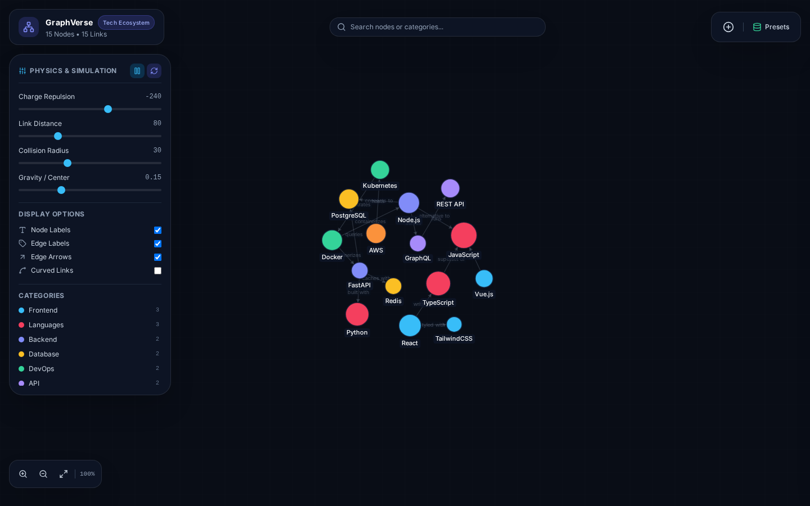

# GraphVerse

A full-bleed, interactive force-directed network graph app built with HTML5 Canvas, D3.js force simulation and Tailwind CSS, in a single HTML file.

**Live demo:** https://aitrendz.org/projects/graphverse/

## Features

- **High-performance canvas rendering:** smooth 60fps rendering with node dragging, hover states, and zoom and pan.
- **Glassmorphism UI controls:** sleek overlay controls over a dark grid backdrop.
- **Node drag and pin:** drag nodes to move them; double-click or use the detail controls to pin and unpin them, shown with indicator rings.
- **Simulation controls:** pause/freeze, reheat, and real-time sliders for link distance, charge repulsion, collision radius and gravity.
- **Search and filter:** autocomplete search with node highlighting, focus navigation and dimming of non-matching nodes.
- **Inspector drawer:** side panel with node properties, degree centrality, connected-neighbour badges and action buttons.
- **Preset datasets:** switch between Tech Ecosystem, Social Network and Biological Pathway, and toggle labels, edge arrows and per-group colours.
- **Add-node modal:** add new nodes and connected edges straight into the running simulation.

## Run it

Open `index.html` in a modern browser. No build step. (This version loads Tailwind, D3, Lucide and Inter from CDNs, so it needs an internet connection.)

## License

MIT © 2026 Richard Balint
